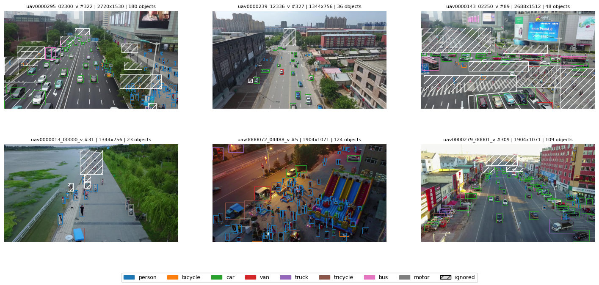
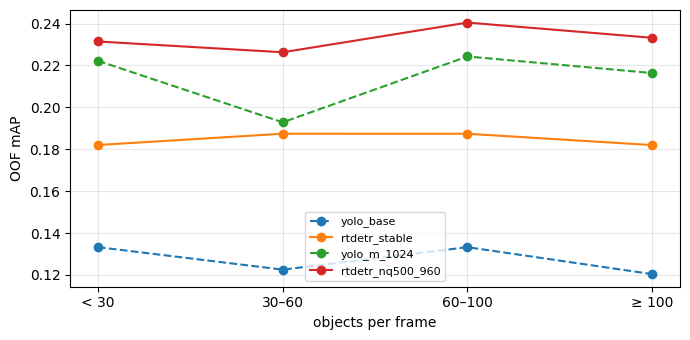
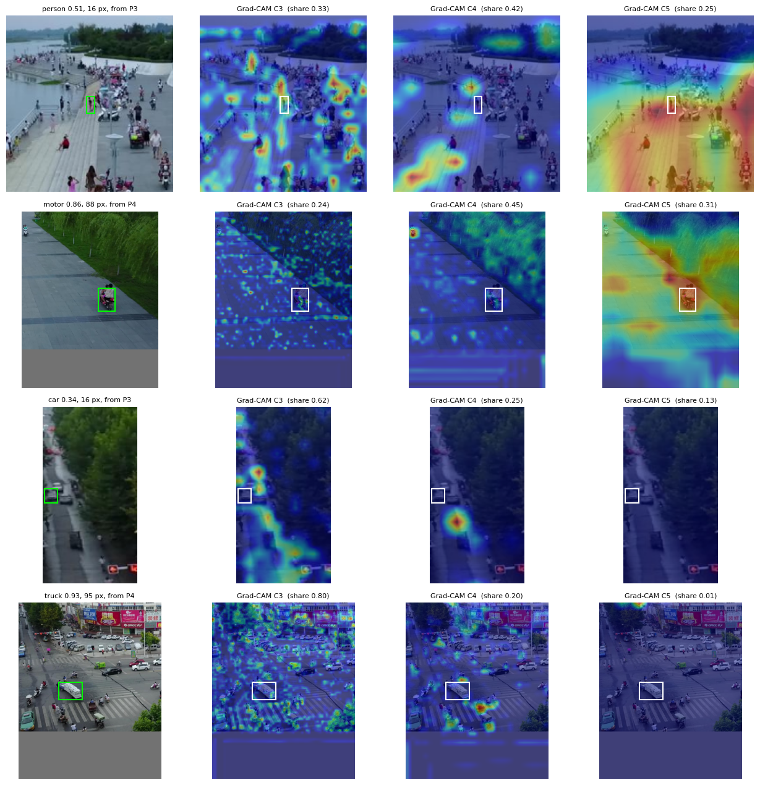
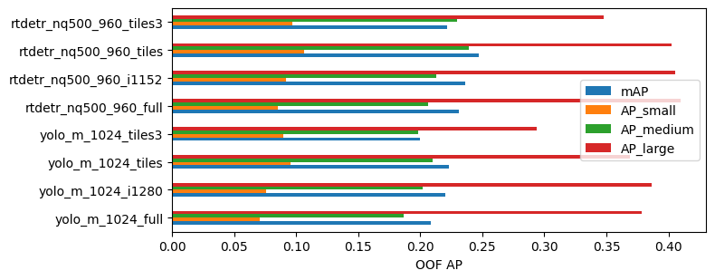
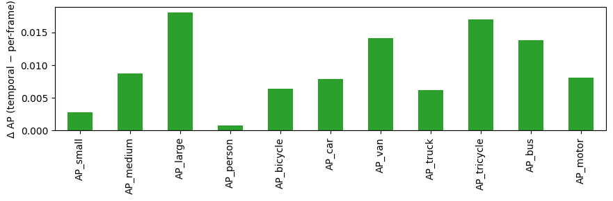

# Multiple Object Video Detection · VisDrone-VID

Object detection in drone video, 8 classes: person, bicycle, car, van, truck, tricycle, bus and motor.
This is team homework 2 of the *Artificial Intelligence* course at UCU (2026), built around a Kaggle competition.

**Public leaderboard: 0.3234 mAP** · OOF mAP 0.279 · [Report](https://kaplysholha.github.io/hw-2/) · [W&B logs](https://wandb.ai/onopriienko-pn-/hw2-ucu-ai-2026)



## Why this data is hard

- **Tiny objects.** At 640 px the median object is 15 px, and 10 % are smaller than the finest FPN stride.
- **Dense scenes.** A frame holds 45 objects on average and up to 180.
- **Strong class imbalance.** Car makes up 44 % of boxes, bus only 0.8 %.
- **Ignored regions** in 72 % of frames (crowds, parking lots), plus test resolutions that never appear in training.

## Approach

We compared four detector families under one protocol:

- **Validation:** 3-fold GroupKFold by clip.
- **Training:** every 20th frame, 12 epochs.
- **Metric:** out-of-fold COCO mAP, with ignored regions counted as `iscrowd`.

| family | model | best OOF mAP |
|---|---|---|
| Two-stage, anchor-based | Faster R-CNN R50-FPN (anchors ×0.5, RoI fraction 0.5) | 0.118 |
| One-stage, anchor-based | RetinaNet R50-FPN (anchors ×0.5, focal γ = 1) | 0.083 |
| One-stage, anchor-free | YOLOv8m @ 1024 px | 0.207 |
| Query-based | RT-DETR-L, 500 queries @ 960 px | 0.229 |

The final pipeline is built from the two strongest families:

```
YOLOv8s / YOLOv8m @1024 ─┐
RT-DETR-L @960 (×2)  ────┼─► WBF of fold models ─► top-300 boxes ─► temporal rescoring + gap filling
2×2 tiled inference  ────┘        (IoU 0.75)                          (track linking across frames)
```

| step | OOF mAP | public LB |
|---|---|---|
| YOLOv8s @1024 (WBF of 3 folds) | 0.189 | 0.252 |
| + RT-DETR, YOLOv8m (3-model WBF) | 0.255 | 0.304 |
| + 2×2 tiles, RT-DETR stride 10 (6 members) | 0.279 | 0.315 |
| + temporal post-processing | — | **0.323** |

## Key findings

- **Pixels per object matter most.** Going from 640 to 1024 px gave YOLO +53 %, and tiled inference gave +8 % per model. Neither needs a new architecture.
- **Architecture and loss tweaks for small objects did not help** under a fixed budget: P2 / no-P5 heads, NWD loss, GIoU, and longer schedules.
- **RT-DETR is robust in dense scenes.** One query per object means no NMS, so its AP stays flat as density grows. At the same resolution it beats YOLOv8s by 50 %, but runs 3× slower.
- **Video context is free accuracy.** Linking detections into tracks and smoothing their scores adds +5 % OOF and +0.008 on the leaderboard.
- **Anchor size must follow the level stride.** k-means anchors are the worst option for RetinaNet: tiny anchors end up on coarse levels.

| | |
|---|---|
|  |  |
|  |  |

## Repository

```
report.md                 full write-up (rendered as the GitHub Pages site)
images/                   figures from all notebooks
notebooks/
  01_eda_and_split        EDA, annotation checks, fixed CV split
  02_faster_rcnn          two-stage detector, RPN vs RoI-head analysis
  02b_retinanet           one-stage anchor-based, anchor-matching analysis
  03_yolo                 YOLOv8 experiments, custom P2 / no-P5 heads
  04_rtdetr               RT-DETR experiments: queries, denoising, loss weights
  05_temporal             TTA and temporal post-processing
  06_ensemble             WBF ensembles and final submission
  07_inference            test-time resolution and tiling
  08_visualization        W&B logging, density analysis, Grad-CAM, RT-DETR attention
  common.py               data loading, splits, COCO evaluation, logging
  tv_*.py / ul_dataset.py torchvision and Ultralytics training code
  ensemble.py, temporal.py
  results.csv             every experiment: per-fold, mean ± std, OOF, FPS, LB
```

## Reproduce

All notebooks run on Kaggle (GPU T4 ×2, Internet on) with the competition data attached. Each notebook clones this repository to get the shared modules. Seed 42 everywhere. Run order and settings for each notebook are in [`notebooks/README.md`](notebooks/README.md).

Main stack: PyTorch, torchvision, Ultralytics 8.4, faster-coco-eval, ensemble-boxes, Weights & Biases.

## Team

- **Olha Kaplysh:** Faster R-CNN, RetinaNet, anchor analysis, error analysis.
- **Darina Onopriienko:** YOLOv8, RT-DETR, ensembling, tiling, temporal post-processing, visualization.
- **Shared:** EDA, validation protocol, evaluation code.
