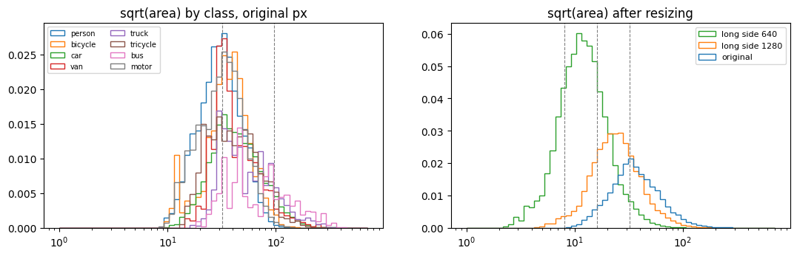
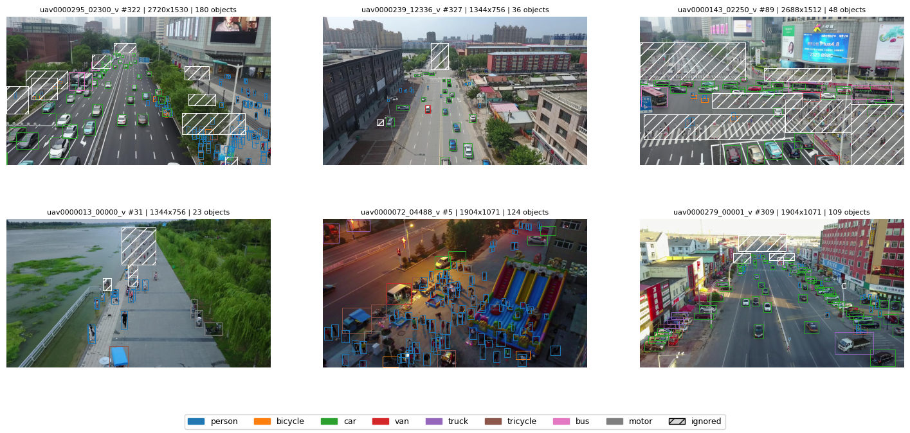
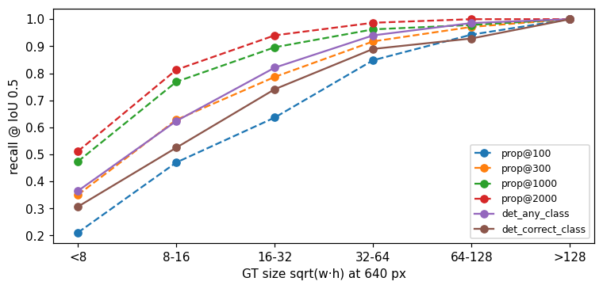
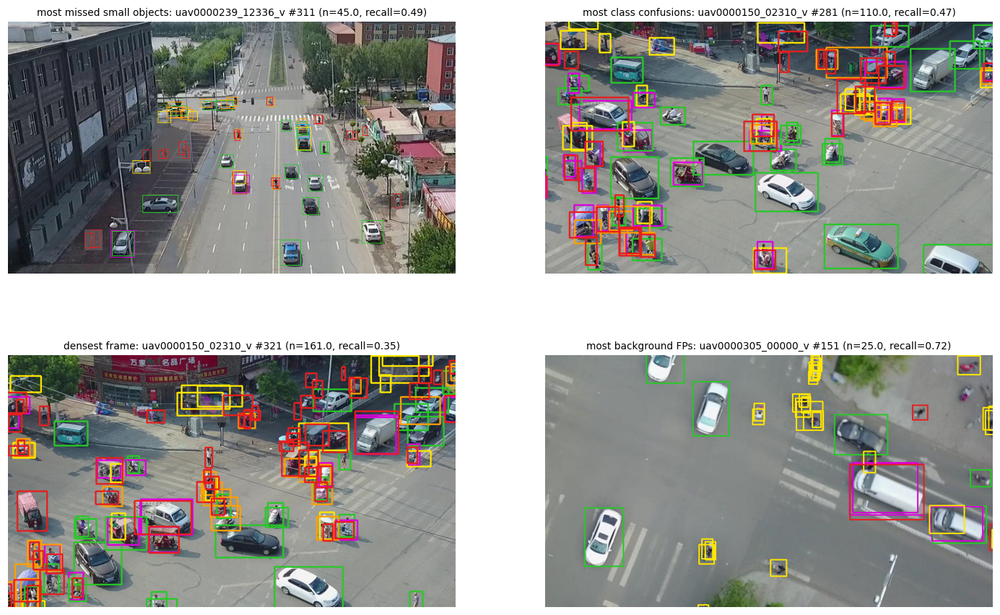
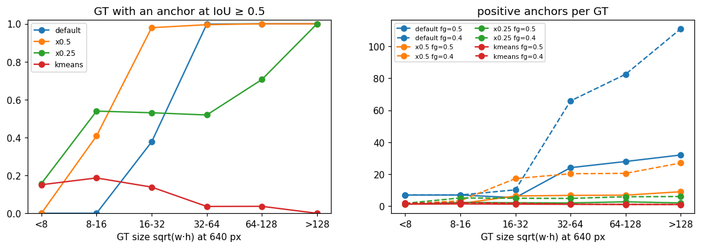
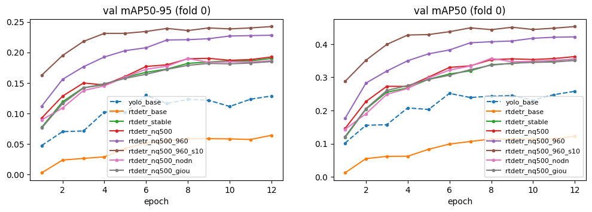
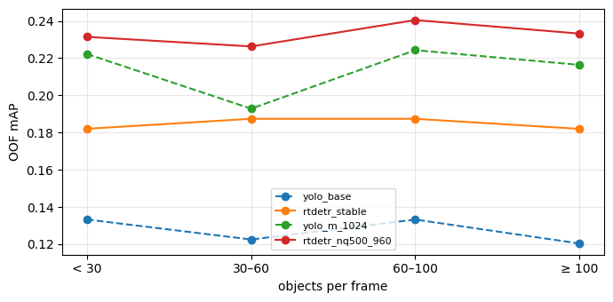
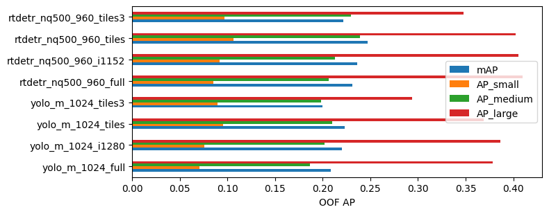
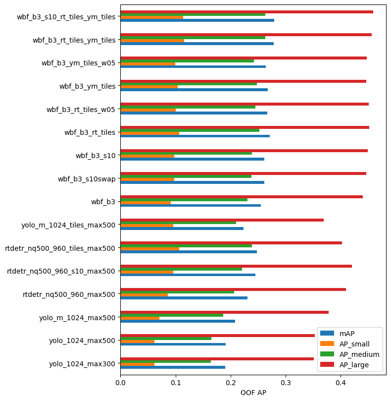

## 1. Data and validation — `01_eda_and_split.ipynb`

- We have analysed 1.22 M boxes, 63 clips. There is an imbalance in classes of objects: car 44 %, person 31 %, bus 0.8 %, so we decided to track per-class AP.
- Bus appears in only 25 of 63 clips, and the share of COCO-small objects ranges from 0 % in low-altitude clips to 73 % in high-altitude ones, so AP of rare classes and AP_small vary between folds.
- median object 46 px original and 15 px after resizing the image to 640 px; 9.7 % of the objects are < 8 px (smaller than the P3 stride). That is why we used higher resolution and applied tiling later.
- There is a max of 180 objects per image, so we set detections_per_img=300 instead of default 100.
- Ignored regions stored 8× in COCO, we decided to keep 1 copy. They are colored gray in training and have iscrowd=1 for all classes in evaluation. Boxes where ≥ 50 % of area covered are dropped.
- The original VisDrone "others" class is not one of the 8 targets, like ignored regions it is stored as `iscrowd=1`.
- Stride 20 keeps 5 % of frames but 96.8 % of tracks

Frames are resized so that the longest side is 640 px (or the larger size of a given experiment). Normalization is done inside each model. Torchvision models use only horizontal flip; Ultralytics models use the default augmentation (mosaic, HSV, scale 0.5, flip) with mosaic switched off for the last 3 epochs. Validation and test frames are not augmented or painted.

We used 3-fold GroupKFold cross-validation, splitting the 63 clips into 42 training and 21 validation clips (the split is saved to `splits.json`; seed 42 is used for training). Each fold used every 20th frame for training and every 10th frame for validation. The splits had different content densities (39–52 objects per frame), so performance was evaluated using both mean ± std and pooled out-of-fold predictions. A sanity check confirmed the evaluator: GT as predictions gives mAP ≈ 1, and false positives inside ignored regions are not penalised. All learned preprocessing, including k-means anchor generation, was fitted only on the training data within each fold to prevent data leakage.

**Common protocol for every model:** 640 px, 12 epochs, COCO-pretrained weights, same folds and frames, `pycocotools` with ignored regions as `iscrowd=1`, FPS at batch 1 on a T4.

## 2. Model comparison

| experiment | px | OOF mAP (± fold std) | AP50 | AP_small | AP_medium | AP_large | FPS |
|---|---|---|---|---|---|---|---|
| `frcnn_base` | 640 | 0.113 ± 0.004 | 0.250 | 0.031 | 0.093 | 0.245 | 24.6 |
| `frcnn_anch05` | 640 | 0.116 ± 0.004 | 0.264 | 0.034 | 0.102 | 0.237 | 23.2 |
| `frcnn_roi05` | 640 | 0.118 ± 0.004 | 0.267 | 0.034 | 0.101 | 0.244 | 24.6 |
| `frcnn_giou` | 640 | 0.117 ± 0.004 | 0.266 | 0.035 | 0.104 | 0.243 | 24.6 |
| `retina_base` | 640 | 0.071 ± 0.003 | 0.150 | 0.007 | 0.048 | 0.213 | 22.4 |
| `retina_anch05` | 640 | 0.080 ± 0.006 | 0.191 | 0.018 | 0.071 | 0.191 | 22.2 |
| `retina_g1` | 640 | 0.083 ± 0.005 | 0.199 | 0.019 | 0.074 | 0.196 | 22.5 |
| `yolo_base` (v8s) | 640 | 0.123 ± 0.002 | 0.252 | 0.037 | 0.108 | 0.274 | 53.6 |
| `yolo_nwd` | 640 | 0.120 ± 0.003 | 0.245 | 0.037 | 0.105 | 0.268 | 51.1 |
| `yolo_p2` | 640 | 0.087 ± 0.006 | 0.196 | 0.028 | 0.089 | 0.171 | 49.0 |
| `yolo_832` | 832 | 0.168 ± 0.012 | 0.327 | 0.054 | 0.145 | 0.324 | 49.8 |
| `yolo_1024` | 1024 | 0.189 ± 0.014 | 0.365 | 0.062 | 0.164 | 0.350 | 48.5 |
| `yolo_1024_p2` | 1024 | 0.187 ± 0.017 | 0.360 | 0.058 | 0.167 | 0.347 | 44.3 |
| `yolo_1024_nop5` | 1024 | 0.182 ± 0.010 | 0.351 | 0.058 | 0.159 | 0.346 | 49.6 |
| `yolo_1024_e24` | 1024 | 0.179 ± 0.008 | 0.348 | 0.061 | 0.154 | 0.339 | 48.2 |
| `yolo_m_1024` (v8m) | 1024 | 0.207 ± 0.006 | 0.390 | 0.070 | 0.185 | 0.375 | 37.5 |
| `rtdetr_base` | 640 | 0.033 ± 0.028 | 0.067 | 0.012 | 0.025 | 0.061 | 18.3 |
| `rtdetr_stable` | 640 | 0.182 ± 0.010 | 0.353 | 0.061 | 0.154 | 0.348 | 18.0 |
| `rtdetr_nq500` | 640 | 0.186 ± 0.010 | 0.364 | 0.066 | 0.159 | 0.346 | 17.9 |
| `rtdetr_nq500_nodn` | 640 | 0.175 ± 0.011 | 0.345 | 0.060 | 0.153 | 0.327 | 18.7 |
| `rtdetr_nq500_giou` | 640 | 0.182 ± 0.011 | 0.353 | 0.060 | 0.158 | 0.336 | 18.6 |
| `rtdetr_nq500_960` | 960 | 0.229 ± 0.016 | 0.437 | 0.085 | 0.204 | 0.407 | 15.2 |
| `rtdetr_nq500_960_s10` | 960 | 0.245 ± 0.015 | 0.468 | 0.096 | 0.220 | 0.420 | – |

### 2.1 Faster R-CNN — `02_faster_rcnn.ipynb`
Torchvision R50-FPN, SGD (LR 0.01), batch 8, LR ×0.1 at epochs 8 and 11. Anchors ×0.5, because a 15 px object has IoU 0.22 with the smallest default anchor (32 px). Raising the RoI positive fraction (0.25 → 0.5) and the GIoU box loss gave improvements that were smaller than the variation between folds, so they showed no significant effect. Of 300 / 1000 / 2000 test-time proposals, 1000 worked best. The RPN covers 77 % of 8–16 px objects, but only 53 % become correct detections: small objects are lost in the second stage, where a 7×7 RoI feature of a 10 px object holds little information. Failure cases (`frcnn_roi05`, figure below):
1. **Tiny distant objects** (5–15 px) at the top of the frame are missed: at stride ≥ 4 the features hold almost no detail, and recall for 8–16 px objects is only 0.16.
2. **Riders:** a person on a motorbike is annotated as two almost fully overlapping boxes; the model often predicts one class for both, which explains the motor ↔ person ↔ bicycle confusions.
3. **Dense scenes** (161 objects, recall 0.35): neighbouring RoIs share features, and NMS at IoU 0.5 can remove true neighbours.
4. **Background false positives** are often real but unlabelled objects (missing annotations).

### 2.2 RetinaNet — `02b_retinanet.ipynb`
With default anchors, no object smaller than 16 px had an anchor with IoU ≥ 0.5. Reducing anchor sizes by 50% increased coverage to 66%, while per-level k-means achieved only 15%, showing that anchor sizes must account for feature-level stride. Focal loss with γ=1 performed better across all folds. Without a proposal stage the model classifies ~46k anchors per frame with only a few hundred positives, boxes are never refined a second time, and duplicates from neighbouring anchors are removed only by NMS. Focal loss and the prior bias initialization address the imbalance. RetinaNet stayed worse than Faster R-CNN on every metric, most of all in AP75 (0.061 vs 0.091) and AP_small (0.019 vs 0.034).

### 2.3 YOLO (anchor-free) — `03_yolo.ipynb`
Search range: input size (640, 832, 1024), NWD loss, P2 head, no P5, 12 vs 24 epochs, YOLOv8s vs YOLOv8m. Without anchors, YOLOv8 takes grid locations whose centre lies inside a GT box as candidates and keeps the best ones by classification score × IoU (TAL). A tiny object covers one or two locations, and 29 % of objects < 8 px share a stride-8 cell with another object, so small objects get very few positives. Resolution had the largest effect (0.123 → 0.168 → 0.189). Results: NWD did not help (0.120 vs 0.123), because AP is averaged up to IoU 0.95 and a softer localisation target loses at high IoU. The first P2 run was unfair (only 219 of 437 weight tensors transferred); with full transfer P2 was still not better than the baseline (0.187 vs 0.189) and trained 2× slower; removing P5 cost 0.007 with almost no change on large objects; 24 epochs overfit (0.179). Selected settings: `yolo_1024` (v8s) and `yolo_m_1024` (v8m, best YOLO at 0.207). Compared with the tuned anchor-based models, YOLO at 640 px is slightly better overall (0.123 vs 0.118) and on small objects (0.037 vs 0.034) and clearly better on large ones (0.274 vs 0.244).

### 2.4 RT-DETR (query-based) — `04_rtdetr.ipynb`
The initial RT-DETR base model suffered from training collapse, which was fixed by removing the bias learning-rate warmup spike (`warmup_bias_lr` 0.1 → 0). 500 queries helped slightly (0.182 → 0.186), while removing denoising (0.175) and changing the GIoU loss weights (0.182) hurt performance. In training, every object is matched to exactly one query by Hungarian matching, and all other queries learn "no object", so the model learns not to produce duplicates and needs no NMS. One positive per object is a sparse signal, which explains the collapse and why denoising matters. Under the same budget RT-DETR learned faster than YOLOv8s (validation mAP 0.08 vs 0.05 after epoch 1, ~0.19 vs ~0.13 after epoch 12). At 640 px it was close to converged (+0.005 over the last 3 epochs); at 960 px it was still rising at epoch 12, so it did not fully converge within the budget. Across scene density RT-DETR stayed within 0.182–0.187 mAP, while YOLO varied more, because nothing is suppressed by NMS. Small objects remain its weak point (AP_small 0.066 at 640 px).

At 640 px resolution, query-based models performed best, followed by anchor-free models, two-stage detectors, and one-stage anchor-based models. The price is speed: RT-DETR runs at about 18 FPS vs 54 FPS for YOLOv8s at 640 px.

## 3. Our pipeline — `07`, `05`, `06`

**Inference strategy, same fold models (no retraining):**

| variant | OOF mAP | AP50 | AP_small | AP_large |
|---|---|---|---|---|
| `rtdetr_nq500_960` full frame | 0.231 ± 0.016 | 0.441 | 0.086 | 0.410 |
| + full frame at 1152 px | 0.236 ± 0.018 | 0.448 | 0.092 | 0.406 |
| + 2×2 tiles | 0.247 ± 0.013 | 0.481 | 0.106 | 0.402 |
| + 3×3 tiles | 0.222 ± 0.007 | 0.446 | 0.097 | 0.348 |
| `yolo_m_1024` full frame | 0.208 ± 0.006 | 0.393 | 0.070 | 0.378 |
| + full frame at 1280 px | 0.220 ± 0.006 | 0.420 | 0.076 | 0.386 |
| + 2×2 tiles | 0.223 ± 0.010 | 0.433 | 0.096 | 0.369 |
| + 3×3 tiles | 0.200 ± 0.008 | 0.401 | 0.089 | 0.294 |
| `yolo_1024` | 0.189 ± 0.014 | 0.365 | 0.062 | 0.350 |
| + TTA (flip + scales) | 0.196 ± 0.014 | 0.374 | 0.062 | 0.371 |
| + temporal rescoring + gap filling | 0.200 ± 0.015 | 0.378 | 0.065 | 0.368 |

**Ensembles (WBF, IoU 0.75):**

| ensemble | OOF mAP | AP_small | public LB |
|---|---|---|---|
| `yolo_1024` + `rtdetr_stable` | 0.215 ± 0.015 | 0.072 | 0.2576 (0.2670 + temporal) |
| B3 = `yolo_m_1024` + `yolo_1024` + `rtdetr_nq500_960` | 0.255 ± 0.016 | 0.091 | 0.3044 (0.3143 + temporal) |
| B3 + RT-DETR tiles | 0.271 ± 0.017 | 0.107 | |
| B3 + YOLOv8m tiles | 0.268 ± 0.016 | 0.104 | |
| B3 + both tiles | 0.278 ± 0.017 | 0.116 | |
| **B3 + s10 + both tiles (final)** | **0.279 ± 0.017** | 0.114 | 0.3151 (**0.3234** + temporal) |

Model and data changes (resolution, YOLOv8m, queries, twice as many training frames in `_s10`: 0.229 → 0.245) are separated from inference changes on the same fold models. 2×2 tiles gave +7 % for both models, mostly from AP_small (+24–36 %), and beat simply feeding a larger frame; 3×3 tiles lost because objects became too large compared with training. TTA gave +0.006 but tripled inference time, so we did not use it. Temporal rescoring and gap filling raised `yolo_1024` from 0.189 to 0.200, with parameters chosen leave-one-fold-out; motion compensation added nothing. For the ensemble the temporal gain was measured only on the leaderboard. Ensembling gave the biggest jump: 0.231 for the best single model, 0.255 for B3, 0.279 with tiles; a fourth model of the same kind did not help.

## 4. Final model and how to run

**Selected submissions:**
1. WBF (IoU 0.75, equal weights) of the 3 fold models of `yolo_m_1024`, `yolo_1024`, `rtdetr_nq500_960`, `rtdetr_nq500_960_s10` + 2×2-tile predictions of `yolo_m_1024` and `rtdetr_nq500_960`, then temporal rescoring (α 0.7, window 10, gap filling), top 300 boxes per frame. OOF 0.279, public 0.3234.
2. Fallback: B3 + temporal. OOF 0.255, public 0.3143.

We use the fold models instead of a full-data retrain: full-data YOLO scored 0.219 public vs 0.252 for WBF of its three fold models.

**Environment:** Kaggle notebook, T4 GPU, data at `/kaggle/input/multiple-object-video-detection-hw-2-ucu-ai-2026/`, `ultralytics==8.4.203`, `ensemble-boxes`, `pycocotools`, seed 42 (`common.seed_everything`). Shared code: `common.py`, `ul_dataset.py`, `tv_dataset.py`, `tv_train.py`, `ensemble.py`, `temporal.py`.

**Order:**
1. `01_eda_and_split.ipynb` (CPU) → `splits.json`, `anchors.json`.
2. `03_yolo.ipynb`, `MODE="full"`, `EXPERIMENT="yolo_1024"`, then `"yolo_m_1024"` (one experiment per commit).
3. `04_rtdetr.ipynb`, `MODE="full"`, `EXPERIMENT="rtdetr_nq500_960"`, then `"rtdetr_nq500_960_s10"`.
4. `07_inference.ipynb` with the outputs of 2–3 attached → tiled OOF and test predictions.
5. `06_ensemble.ipynb`, `MODE="predict"`, then `MODE="tune"` → `submission_best.csv`.
6. `05_temporal.ipynb` with the `06` output attached → `submission_best_temporal.csv` (submitted file).

`02_faster_rcnn.ipynb` and `02b_retinanet.ipynb` are comparison runs only and are not needed for the submission.

## 5. Conclusions
Small objects were the main challenge, and more pixels per object (resolution, tiles) helped more than any head or loss change. At equal budget the query-based RT-DETR was the strongest and least sensitive to density, but about 3× slower than YOLO. Fusing models that fail differently gave the largest pipeline gain, and the consecutive frames gave a cheap extra +5 % through temporal post-processing. OOF and public LB moved together, so the clip-level CV was reliable for model selection.

Training logs, curves and validation predictions: [W&B project](https://wandb.ai/onopriienko-pn-/hw2-ucu-ai-2026).

## References
- Ren et al. Faster R-CNN. arXiv:1506.01497
- Lin et al. Feature Pyramid Networks. arXiv:1612.03144
- Lin et al. Focal Loss for Dense Object Detection (RetinaNet). arXiv:1708.02002
- Redmon, Farhadi. YOLO9000 (k-means anchors). arXiv:1612.08242
- Rezatofighi et al. GIoU. arXiv:1902.09630
- Wang et al. Normalized Wasserstein Distance. arXiv:2110.13389
- Feng et al. TOOD (task-aligned assignment). arXiv:2108.07755
- Carion et al. DETR. arXiv:2005.12872
- Zhu et al. Deformable DETR. arXiv:2010.04159
- Li et al. DN-DETR. arXiv:2203.01305
- Zhao et al. RT-DETR. arXiv:2304.08069
- Akyon et al. SAHI. arXiv:2202.06934
- Solovyev et al. Weighted Boxes Fusion. arXiv:1910.13302
- Kang et al. T-CNN. arXiv:1604.02532; Han et al. Seq-NMS. arXiv:1602.08465
- Selvaraju et al. Grad-CAM. arXiv:1610.02391
- Zhu et al. VisDrone. arXiv:2001.06303
- Libraries: torchvision detection references, Ultralytics, ensemble-boxes, pycocotools
